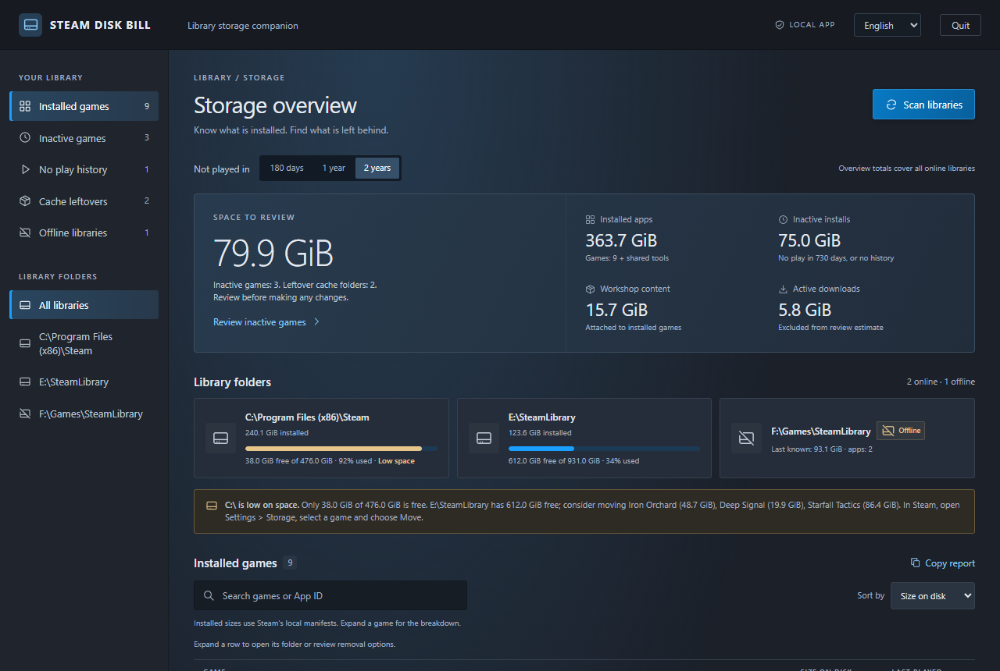
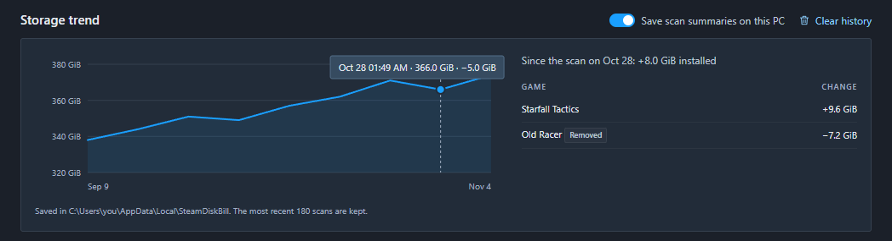
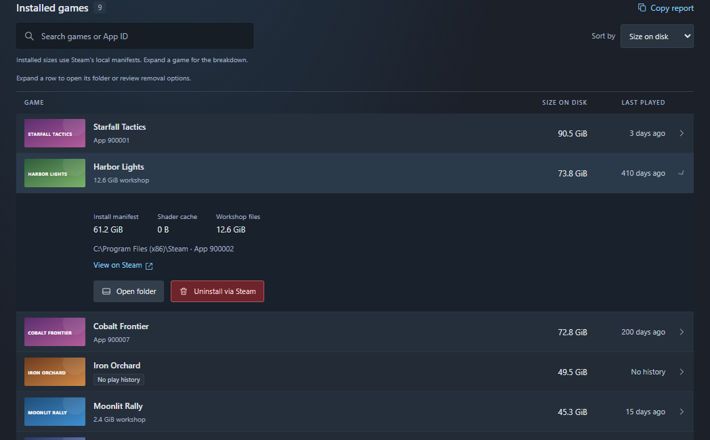

# Steam Disk Bill

A Windows app that reads your local Steam libraries and shows where the disk space went. Nothing is cleaned automatically; every removal needs explicit confirmation. Simplified Chinese and English UI.



<sub>Screenshots use made-up demo data (`tools/readme-shots.mjs`).</sub>

## Run it

**Packaged:** download `Steam Disk Bill.exe` from [Releases](https://github.com/Leonhart999/steam-disk-bill/releases) and double-click it. No installer and no Node.js needed. The exe is not code-signed, so Windows SmartScreen may ask you to confirm the first time.

**From source:** double-click [Steam Disk Bill.vbs](Steam%20Disk%20Bill.vbs) (needs Node.js 22 or newer), or run [steam-disk-bill-console.bat](steam-disk-bill-console.bat) to keep a console open. The launcher looks for `D:\Programs\nodejs\node.exe`, then `node` on `PATH`.

Either way, a local server starts on `127.0.0.1:47331` and Microsoft Edge opens it as an app window. Closing the window stops the server. Set `STEAM_PATH` if Steam is not found automatically.

## What it shows

- installed size, free space and a usage bar per library drive
- installs not played for 180 / 365 / 730 days, or with no local play history
- shader cache and workshop folders left behind after a game was uninstalled
- libraries on drives that are not connected, using the sizes Steam last recorded
- in-progress downloads, shown separately and excluded from the review estimate

Leftover caches and offline games have no install manifest, so their names are read from Steam's local app cache (`appcache/appinfo.vdf`). Nothing is fetched from the internet; cover art also comes from Steam's local cache. When the UI is Chinese and Steam has a Simplified Chinese name for a game, that name is shown.

**Space to review** is a candidate estimate, not a guarantee that files can be safely removed. A missing play-history timestamp is labeled **No play history**, not as proof a game was never played.

## Low space and moving games

A drive counts as low on space below 10% or 20 GiB free. If another connected library drive has room, the app suggests up to three games to move there, inactive games first. Moving is done by Steam itself (Settings > Storage > select a game > Move); this app does not copy game files.

## Storage trend (optional)



Off by default. Turn on **Save scan summaries on this PC** and each scan saves totals and per-game sizes to `%LOCALAPPDATA%\SteamDiskBill\history.json` (the latest 180 scans). The chart shows installed size over time and the list shows which games grew, shrank, appeared or disappeared since the previous scan. Turning it off stops saving; **Clear history** deletes the file. Nothing is uploaded.

## Open folder and removal



Expand a row to open its folder in Explorer, or use the red button:

- **Uninstall via Steam** for games sends `steam://uninstall/<appid>` through the same `steam.exe -- <url>` handler Steam registers for its links. Steam shows its own dialog; this app never deletes game folders.
- **Delete cache** for leftover shader or workshop folders moves the folder to the Recycle Bin through the Windows shell. If Windows warns that it cannot recycle and would delete permanently, choose No.

Safeguards:

- a required checkbox and a one-time confirmation ticket that expires after two minutes
- a per-session token on the local API, with host and origin checks
- re-validation against Steam's files right before acting; a rescan invalidates old targets
- linked paths (junctions or symlinks) at or inside a target are refused
- cache deletion is blocked while Steam is running, while Steam still has an install, download or library record for that app, or when the scan reported warnings
- only one action runs at a time

## Develop

```bash
npm install --cache D:/Caches/npm
npm run test:actions   # removal safeguards against a throwaway Steam layout in .test-tmp/
npm run test:ui        # Playwright + installed Edge against the real local library
npm run build          # dist/Steam Disk Bill.exe
```

- `test:actions` uses fake Windows side effects, so no real files are touched.
- `test:ui` opens the removal dialog and cancels it, so nothing is uninstalled or deleted. History is written to `.test-tmp/` instead of your profile. Set `DISK_BILL_EXE="dist/Steam Disk Bill.exe"` to run the same checks against the packaged build. Stop a running instance first so the test can use the port.
- `build` bundles the server with esbuild, embeds the page and the Recycle Bin helper as Node single-executable assets, sets the icon and version with rcedit, and switches the exe to the Windows GUI subsystem so no console appears.
- `node tools/readme-shots.mjs` regenerates the screenshots in `docs/` from demo data. `node tools/make-icon.mjs` rebuilds `assets/icon.ico` from `assets/icon.svg`.

Layout: `src/scan.mjs` reads libraries and caches, `src/appinfo.mjs` reads names from Steam's binary app cache, `src/actions.mjs` handles open/removal requests, `src/history.mjs` stores the optional summaries, and `src/server.mjs` serves the UI in `app/`. A text summary without the window: `node tools/preview.mjs --days 365`.

## License

[MIT](LICENSE)
